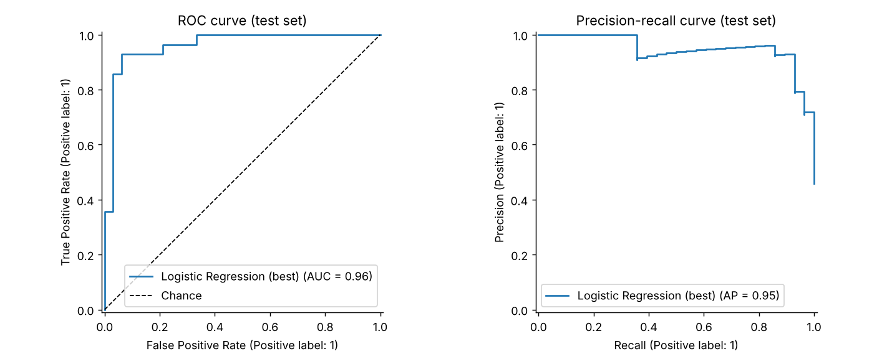
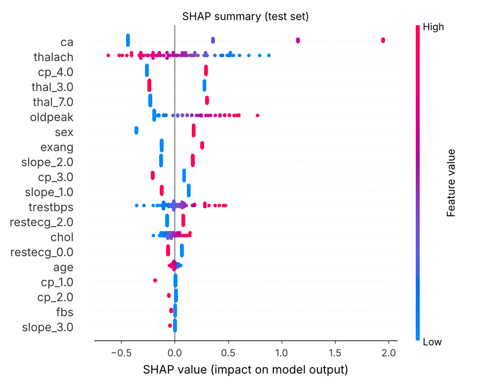
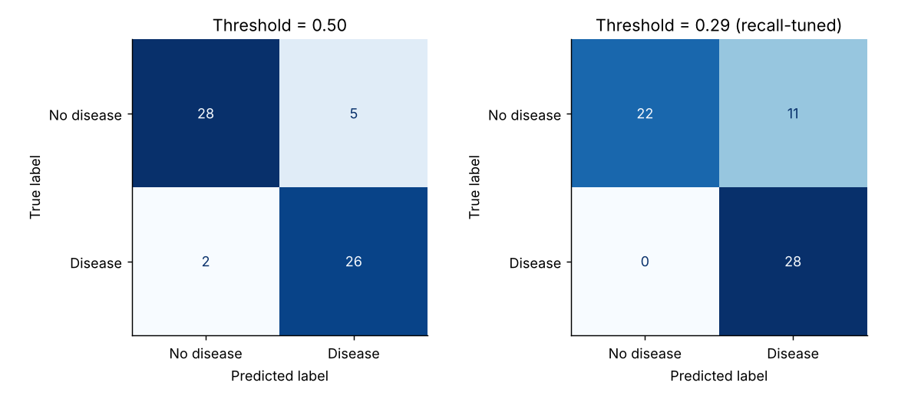

# Predicting Heart Disease Risk: A Clinical Classification Study with Interpretable Machine Learning

End-to-end binary classification on the **UCI Heart Disease (Cleveland)** dataset: data cleaning, EDA with statistical tests, leak-free modeling pipelines, repeated cross-validation, hyper-parameter tuning, recall-oriented threshold selection, SHAP/permutation interpretability, a subgroup check, and a Streamlit demo.

> **Disclaimer:** educational portfolio project on 303 patients from a single 1980s source. It is **not** a clinical tool.

## Headline results

| Metric | Value |
|---|---|
| Cross-validated ROC-AUC (train set, tuned logistic regression) | **0.90** |
| Hold-out test ROC-AUC (n = 61) | **0.96** (95% bootstrap CI 0.91-1.00) |
| Test accuracy / precision / recall @ threshold 0.50 | 0.89 / 0.84 / 0.93 |
| Test recall / precision @ recall-tuned threshold (0.29) | 1.00 / 0.72 |

Key findings:
- **A tuned logistic regression was the best model**, ahead of SVM, Random Forest and XGBoost. On ~240 training rows the differences are within one standard deviation, so simpler and interpretable wins.
- The 61-row test set gives a wide CI; treat the **CV AUC (~0.90) as the more reliable estimate**.
- Strongest risk factors: number of major vessels coloured (`ca`), asymptomatic chest pain (`cp = 4`), reversible-defect thal, male sex, exercise-induced angina, ST depression; lower max heart rate lowers risk.
- Lowering the threshold to favour recall catches every positive case in the test set at the cost of more false alarms (specificity 0.67).

## Project structure
```
data/raw/heart_disease.csv        original data (target `num` 0-4)
data/processed/heart_clean.csv    binarised target, de-duplicated
notebooks/01_eda.ipynb            EDA, chi-square / Mann-Whitney tests
notebooks/02_preprocessing.ipynb  preprocessing pipeline walkthrough
notebooks/03_modeling.ipynb       model comparison, evaluation, interpretability
src/data_prep.py                  loading, cleaning, ColumnTransformer, splits
src/train.py                      7-model CV comparison + grid-search tuning
src/evaluate.py                   test metrics, curves, SHAP, fairness table
models/                           saved pipelines + metadata
reports/                          metrics.json, tables, figures/
app/streamlit_app.py              interactive risk estimator
```

## Method
1. **Target:** `num > 0` -> disease (46% prevalence). 
2. **Preprocessing (inside the Pipeline, so no leakage):** median impute + scale numerics (`age, trestbps, chol, thalach, oldpeak, ca`); mode impute + one-hot for `cp, restecg, slope, thal`; binaries passed through. Only 6 values are missing (`ca`: 4, `thal`: 2).
3. **Split:** stratified 80/20; test set untouched until final evaluation.
4. **Models:** Logistic Regression, KNN, Naive Bayes, SVM, Random Forest, Gradient Boosting, XGBoost compared with 5-fold x 3-repeat stratified CV; four of them tuned with `GridSearchCV` (ROC-AUC).
5. **Threshold:** chosen from out-of-fold *training* predictions to reach >= 90% recall, then applied once to the test set.
6. **Interpretability:** odds ratios, permutation importance (AUC drop), SHAP.
7. **Subgroup check:** AUC / recall / precision by sex and age band (groups of 6-41 patients: indicative only).

### Cross-validated comparison (train set)
| Model | ROC-AUC | Recall |
|---|---|---|
| Logistic Regression | 0.892 ± 0.043 | 0.762 |
| Random Forest | 0.888 ± 0.042 | 0.753 |
| KNN | 0.879 ± 0.041 | 0.792 |
| SVM (RBF) | 0.878 ± 0.045 | 0.759 |
| XGBoost | 0.862 ± 0.039 | 0.762 |
| Naive Bayes | 0.859 ± 0.057 | 0.882 |
| Gradient Boosting | 0.848 ± 0.045 | 0.765 |

After tuning: Logistic Regression 0.900, SVM 0.895, Random Forest 0.892, XGBoost 0.881.

## Reproduce
```bash
python -m venv .venv && source .venv/bin/activate
pip install -r requirements.txt
python -m src.data_prep      # cleaned data
python -m src.train          # compare + tune, saves models/
python -m src.evaluate       # metrics + figures in reports/
streamlit run app/streamlit_app.py
```

## Figures




## Limitations
- Small, single-site, older cohort; 68% male. Results may not generalise.
- The test set has 61 patients, so test metrics carry large uncertainty.
- Predictors include invasive/advanced test results (`ca`, `thal`), so this is not a pre-screening tool as framed.
- The binary target pools all severity levels (1-4).

## Possible next steps
Add the Hungarian / Swiss / VA subsets for external validation, probability calibration (isotonic/Platt), nested CV, and decision-curve analysis.
